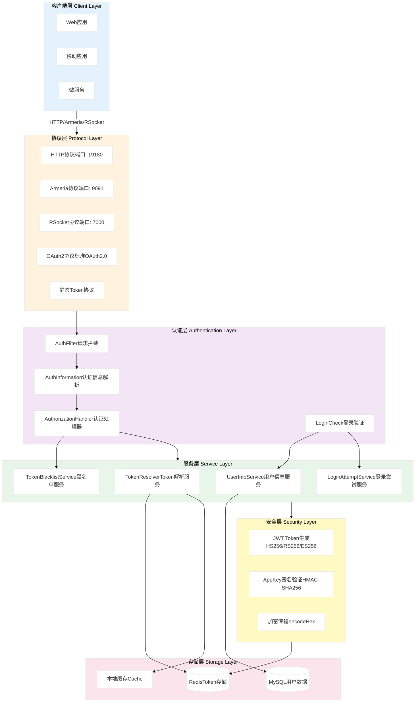
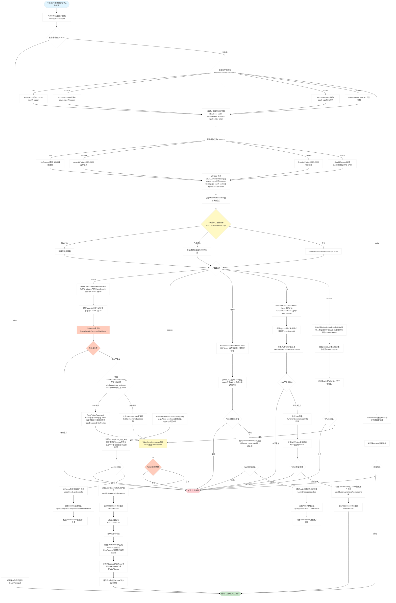
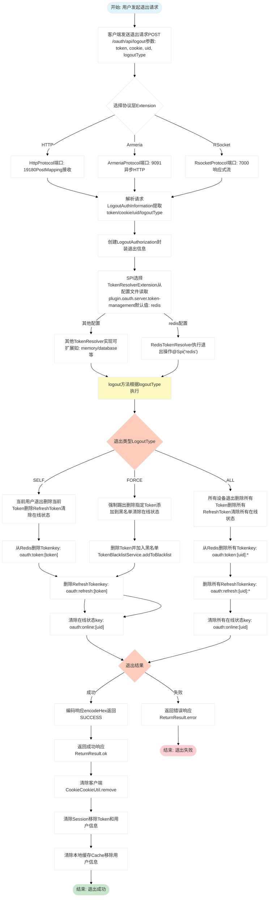

# Spring API Support OAuth Starter

## 📖 模块简介

Spring API Support OAuth Starter 是一个功能完整的 OAuth 认证服务端/单点登录（SSO）系统。该模块提供了完整的 OAuth 认证服务，支持多种通信协议，包括 HTTP、Armeria、RSocket、OAuth2、TCP、UDP 等，可以作为企业级单点登录解决方案的核心服务。

## ✨ 核心功能

### 🔐 OAuth 认证服务

- **多种登录方式** - 支持 **8种登录类型**：
  - **WEB** - 用户名密码登录（UserLoginService）
  - **TENANT** - 多租户登录（TenantUserLoginService）
  - **GITEE** - Gitee 第三方登录（GiteeLoginService）
  - **GITHUB** - GitHub 第三方登录（GithubLoginService）
  - **WECHAT** - 企业微信登录（WechatEnterpriseLoginService）
  - **MINI** - 微信小程序登录（WeixinMiniLoginService）
  - **DINGTALK** - 钉钉登录（DingtalkLoginService）
  - **TEMP** - 临时 Token 登录（TemporaryTokenLoginService）
- **登录数量控制** - 支持 **3种在线模式**：
  - **SINGLE** - 单点登录，同一用户只能在一个设备登录（新登录会踢掉旧设备）
  - **MULTIPLE** - 多点登录，同一用户可以在多个设备同时登录（无限制）
  - **LIMIT** - 限制登录，同一用户最多在指定数量的设备上登录（可配置最大在线数）
- **令牌管理** - 完整的 Token 生成、验证、刷新、撤销机制
- **会话管理** - 基于 Redis 的分布式会话管理
- **用户信息服务** - 提供用户详细信息查询

### 🌐 多协议支持

- **HTTP 协议** - 标准的 RESTful API
- **Armeria 协议** - 基于 Armeria 框架的高性能异步 HTTP 通信
- **RSocket 协议** - 响应式流协议，支持双向通信
- **OAuth2 协议** - 符合 RFC 6749 标准的 OAuth 2.0 协议
- **TCP 协议** - 二进制 TCP 通信
- **UDP 协议** - 无连接 UDP 通信

### 👥 用户管理

- **用户 CRUD** - 完整的用户增删改查
- **角色管理** - 灵活的角色权限体系
- **部门管理** - 组织架构管理
- **租户管理** - 多租户数据隔离
- **用户日志** - 完整的用户操作日志

### 🔒 安全机制

- **签名验证** - 请求签名校验
- **防重放攻击** - 时间戳和 UUID 验证
- **AK/SK 认证** - 应用密钥认证
- **加密传输** - 支持多种加密算法
- **IP 白名单** - IP 访问控制

## 🚀 快速开始

### Maven 依赖

```xml
<dependency>
    <groupId>com.chua</groupId>
    <artifactId>spring-api-support-oauth-starter</artifactId>
    <version>4.0.0</version>
</dependency>
```

### 数据库初始化

1. 创建数据库：

```sql
CREATE DATABASE oauth DEFAULT CHARACTER SET utf8mb4 COLLATE utf8mb4_unicode_ci;
```

2. 执行初始化脚本：

```bash
# 位于 src/main/resources/sql/ 目录下
mysql -u root -p oauth < oauth.sql
mysql -u root -p oauth < sys_app_key.sql
mysql -u root -p oauth < app_id.sql
```

### 基础配置

```yaml
spring:
  application:
    name: oauth-server
  profiles:
    active: dev

  # 数据源配置
  datasource:
    url: jdbc:mysql://localhost:3306/oauth?useUnicode=true&characterEncoding=utf8&useSSL=false
    username: root
    password: your_password
    driver-class-name: com.mysql.cj.jdbc.Driver

  # Redis 配置
  redis:
    host: localhost
    port: 6379
    password:
    database: 0

server:
  port: 19180
  servlet:
    context-path: /oauth

# OAuth 服务配置
plugin:
  oauth:
    server:
      # 支持的协议
      protocols: [http, armeria, rsocket, oauth2]
      # Armeria 端口
      armeria-port: 9091
      # RSocket 端口
      rsocket-port: 7000
      # Token 过期时间（秒）
      token-timeout: 7200
      # 刷新 Token 过期时间（秒）
      refresh-token-timeout: 604800
      # 在线模式配置
      # SINGLE: 单点登录，同一用户只能在一个地方登录，新登录会踢掉所有旧设备
      # MULTIPLE: 多点登录，同一用户可以在多个地方同时登录（无限制）
      # LIMIT: 限制登录，同一用户最多在指定数量的设备上登录，超过限制时拒绝新登录
      online: MULTIPLE
      # 最大在线设备数量（仅当 online = LIMIT 时生效）
      max-online-count: 3
```

## 📋 数据库设计

### 核心表结构

#### sys_user - 用户表

```sql
CREATE TABLE `sys_user` (
  `user_id` bigint NOT NULL AUTO_INCREMENT COMMENT '用户ID',
  `username` varchar(50) NOT NULL COMMENT '用户名',
  `password` varchar(100) NOT NULL COMMENT '密码',
  `real_name` varchar(50) COMMENT '真实姓名',
  `email` varchar(100) COMMENT '邮箱',
  `phone` varchar(20) COMMENT '手机号',
  `status` tinyint DEFAULT 1 COMMENT '状态：0-禁用，1-启用',
  `is_admin` tinyint DEFAULT 0 COMMENT '是否管理员',
  `dept_id` bigint COMMENT '部门ID',
  `tenant_id` bigint COMMENT '租户ID',
  `create_time` datetime DEFAULT CURRENT_TIMESTAMP,
  `update_time` datetime DEFAULT CURRENT_TIMESTAMP ON UPDATE CURRENT_TIMESTAMP,
  PRIMARY KEY (`user_id`),
  UNIQUE KEY `uk_username` (`username`)
) COMMENT='用户表';
```

#### sys_role - 角色表

```sql
CREATE TABLE `sys_role` (
  `role_id` bigint NOT NULL AUTO_INCREMENT COMMENT '角色ID',
  `role_name` varchar(50) NOT NULL COMMENT '角色名称',
  `role_code` varchar(50) NOT NULL COMMENT '角色编码',
  `description` varchar(200) COMMENT '描述',
  `status` tinyint DEFAULT 1 COMMENT '状态',
  `tenant_id` bigint COMMENT '租户ID',
  PRIMARY KEY (`role_id`)
) COMMENT='角色表';
```

#### sys_app_key - 应用密钥表

```sql
CREATE TABLE `sys_app_key` (
  `sys_app_key_id` int NOT NULL AUTO_INCREMENT COMMENT '主键ID',
  `sys_app_key_app_id` varchar(100) COMMENT '应用ID',
  `app_key` varchar(100) NOT NULL COMMENT 'AppKey',
  `sys_app_key_secret` varchar(100) NOT NULL COMMENT 'AppSecret',
  `sys_app_key_name` varchar(100) COMMENT '应用名称',
  `sys_user_id` int COMMENT '用户ID',
  `sys_app_key_status` tinyint DEFAULT 1 COMMENT '状态：0-禁用，1-启用',
  `sys_app_key_delete` tinyint DEFAULT 0 COMMENT '删除标记：0-未删除，1-已删除',
  `sys_app_key_expire_time` bigint COMMENT '过期时间（时间戳）',
  `sys_app_key_ip_whitelist` varchar(500) COMMENT 'IP白名单，多个用逗号分隔',
  `sys_app_key_remark` varchar(500) COMMENT '备注',
  `sys_app_key_last_used_time` bigint COMMENT '最后使用时间（时间戳）',
  `sys_app_key_use_count` int DEFAULT 0 COMMENT '使用次数',
  `create_name` varchar(100) COMMENT '创建人名称',
  `create_by` int COMMENT '创建人ID',
  `create_time` datetime DEFAULT CURRENT_TIMESTAMP COMMENT '创建时间',
  `update_time` datetime DEFAULT CURRENT_TIMESTAMP ON UPDATE CURRENT_TIMESTAMP COMMENT '更新时间',
  `update_name` varchar(100) COMMENT '更新人名称',
  `update_by` int COMMENT '更新人ID',
  `sys_app_key_scope` varchar(500) COMMENT '允许的权限范围，多个用逗号分隔，如：read,write,admin',
  `sys_app_key_grant_types` varchar(500) COMMENT '允许的授权类型，多个用逗号分隔，如：client_credentials,password,authorization_code,refresh_token',
  `sys_app_key_redirect_uris` varchar(1000) COMMENT '允许的回调地址，多个用逗号分隔，用于 authorization_code 模式的 redirect_uri 校验',
  `sys_app_key_enable_fingerprint` int DEFAULT 0 COMMENT '是否启用指纹检测 - 已废弃，指纹校验在客户端进行',
  `sys_app_key_fingerprint_whitelist` varchar(1000) COMMENT '允许的指纹列表 - 已废弃，不再使用',
  PRIMARY KEY (`sys_app_key_id`),
  UNIQUE KEY `uk_app_key` (`app_key`),
  KEY `idx_sys_app_key_app_id` (`sys_app_key_app_id`),
  KEY `idx_sys_user_id` (`sys_user_id`)
) COMMENT='应用密钥表';
```

#### app_id - AppId应用标识表

```sql
CREATE TABLE `app_id` (
  `app_id_id` int NOT NULL AUTO_INCREMENT COMMENT 'AppId ID - 主键自增',
  `app_id_value` varchar(100) NOT NULL COMMENT 'AppId值 - 应用唯一标识符，全局唯一',
  `app_id_name` varchar(100) COMMENT 'AppId名称 - 应用的显示名称',
  `app_id_description` varchar(500) COMMENT '应用描述 - 应用的详细说明',
  `app_id_status` int DEFAULT 1 COMMENT '应用状态 - 0:禁用, 1:启用',
  `app_id_expire_time` bigint COMMENT '过期时间 - Unix时间戳(毫秒)，NULL表示永不过期',
  `app_id_last_use_time` bigint COMMENT '最后使用时间 - Unix时间戳(毫秒)，最近一次使用该AppId的时间',
  `app_id_use_count` bigint DEFAULT 0 COMMENT '使用次数 - 该AppId累计被调用的次数',
  `user_id` int COMMENT '关联用户ID - 该AppId所属的用户ID',
  `app_id_scope` varchar(500) COMMENT '允许的权限范围 - 多个scope用逗号分隔，如"read,write,admin"',
  `app_id_grant_types` varchar(500) COMMENT '允许的授权类型 - 多个用逗号分隔，如"client_credentials,password,authorization_code,refresh_token"',
  `app_id_redirect_uris` varchar(1000) COMMENT '允许的回调地址 - 多个用逗号分隔，用于authorization_code模式的redirect_uri校验',
  `app_id_remark` varchar(500) COMMENT '备注信息',
  `delete_flag` int DEFAULT 0 COMMENT '删除标记 - 0:未删除, 1:已删除',
  `create_name` varchar(255) COMMENT '创建人姓名',
  `create_by` int COMMENT '创建人ID',
  `create_time` datetime DEFAULT CURRENT_TIMESTAMP COMMENT '创建时间',
  `update_time` datetime DEFAULT CURRENT_TIMESTAMP ON UPDATE CURRENT_TIMESTAMP COMMENT '更新时间',
  `update_name` varchar(255) COMMENT '更新人姓名',
  `update_by` int COMMENT '更新人ID',
  PRIMARY KEY (`app_id_id`),
  UNIQUE KEY `uk_app_id_value` (`app_id_value`) COMMENT 'AppId值唯一索引 - 确保AppId不重复',
  KEY `idx_status` (`app_id_status`) COMMENT '状态索引 - 用于快速查询启用的应用',
  KEY `idx_expire_time` (`app_id_expire_time`) COMMENT '过期时间索引 - 用于清理过期AppId',
  KEY `idx_user_id` (`user_id`) COMMENT '用户ID索引 - 用于查询某用户的所有AppId',
  KEY `idx_delete_flag` (`delete_flag`) COMMENT '删除标记索引 - 用于软删除查询'
) COMMENT='AppId应用标识表 - 存储AppId相关信息，与app_key表是并列关系';
```

> 💡 **说明**: `app_id` 表用于存储AppId相关信息，与 `app_key` 表是**并列关系**（不是子集关系）。AppId是应用的唯一标识符，支持过期时间、权限范围、授权类型等配置。在AppKey认证流程中，系统会验证AppId的有效性，并更新使用信息。

## 🔧 协议使用说明

### 1. HTTP 协议

#### 用户登录

```bash
POST /oauth/api/login
Content-Type: application/json

{
  "username": "admin",
  "password": "123456",
  "appKey": "your_app_key",
  "timestamp": 1701234567890,
  "sign": "calculated_signature"
}
```

#### Token 验证

```bash
POST /oauth/api/authenticate
Content-Type: application/json

{
  "token": "your_access_token",
  "appKey": "your_app_key",
  "timestamp": 1701234567890,
  "sign": "calculated_signature"
}
```

#### Token 刷新

```bash
POST /oauth/api/upgrade
Content-Type: application/json

{
  "refreshToken": "your_refresh_token",
  "appKey": "your_app_key",
  "timestamp": 1701234567890,
  "sign": "calculated_signature"
}
```

### 2. Armeria 协议

Armeria 协议提供高性能的异步 HTTP 通信，基于 Netty 框架。

#### 客户端调用示例

```java
// 使用 Armeria 客户端
WebClient client = WebClient.builder("http://localhost:9091")
    .build();

// 登录请求
AuthRequest authRequest = new AuthRequest();
authRequest.setData(encryptedData);

CompletableFuture<HttpResponse> future = client.post("/login")
    .content(MediaType.JSON, Json.toJson(authRequest))
    .execute();
```

### 3. RSocket 协议

RSocket 协议提供响应式流通信，支持双向通信。

#### 客户端调用示例

```java
// 创建 RSocket 客户端
RSocket rsocket = RSocketConnector.create()
    .connect(TcpClientTransport.create("localhost", 7000))
    .block();

// 发送请求
Payload request = DefaultPayload.create(
    Json.toJson(authRequest),
    "/login"
);

Mono<Payload> response = rsocket.requestResponse(request);
```

### 4. OAuth2 协议

OAuth2 协议符合 RFC 6749 标准，支持多种授权模式。

#### 授权码模式示例

```bash
# 1. 获取授权码
GET /oauth2/authorize?response_type=code&client_id=your_client_id&redirect_uri=http://callback

# 2. 使用授权码获取Token
POST /oauth2/token
Content-Type: application/x-www-form-urlencoded

grant_type=authorization_code&code=authorization_code&redirect_uri=http://callback
```

### 5. TCP/UDP 协议

TCP 和 UDP 协议使用二进制格式传输，适合高性能场景。

## 🔐 安全机制

### 签名算法

所有请求都需要签名验证，签名算法如下：

```java
// 1. 按参数名排序
Map<String, String> params = new TreeMap<>();
params.put("username", "admin");
params.put("password", "123456");
params.put("appKey", "your_app_key");
params.put("timestamp", "1701234567890");

// 2. 拼接字符串
StringBuilder sb = new StringBuilder();
for (Map.Entry<String, String> entry : params.entrySet()) {
    sb.append(entry.getKey()).append("=").append(entry.getValue()).append("&");
}
sb.append("appSecret=").append(appSecret);

// 3. MD5 加密
String sign = DigestUtils.md5Hex(sb.toString());
```

### AppKey 和 AppId 认证

系统支持两种独立的认证方式：**AppKey 认证**和 **AppId 认证**，它们是并列关系，各自独立处理。

#### AppKey 认证（AppKeyAuthorizationHandler）

**认证流程：**
1. 从请求中提取 `appKey`（通过 `userCode` 参数传递）
2. **从 `sys_app_key` 表查询 AppKey，验证是否与数据库一致**
3. 检查 AppKey 状态（是否启用）
4. 检查 AppKey 过期时间
5. 通过 `code` 参数获取用户信息
6. 返回用户信息（`UserResume`）

**特点：**
- **只需与数据库核对是否一致**，不需要加密计算
- AppKey 存储在 `sys_app_key` 表中
- 认证成功后返回关联的用户信息

**使用示例：**

```bash
POST /oauth/api/authenticate
Content-Type: application/json

{
  "userCode": "your_app_key",
  "code": "user_unique_code"
}
```

#### AppId 认证（AppIdAuthorizationHandler）

**认证流程：**
1. 从请求中提取 `appId`（通过请求头 `x-oauth-app-id` 或请求体传递）
2. **从 `app_id` 表查询 AppId，验证是否存在**
3. 检查 AppId 状态（是否启用）
4. 检查 AppId 过期时间
5. **使用 `AppIdValidator` 计算加密验证**（支持 HMAC-SHA256 或默认验证器）
6. 通过 `code` 参数获取用户信息
7. 返回用户信息（`UserResume`）

**特点：**
- **需要与数据库核对是否一致，并且需要计算加密验证**
- AppId 存储在 `app_id` 表中
- 支持多种验证器（`DefaultAppIdValidator`、`HmacSha256AppIdValidator`）
- 认证成功后返回关联的用户信息

**验证器说明：**
- **DefaultAppIdValidator**：默认验证器，仅从数据库查询验证
- **HmacSha256AppIdValidator**：HMAC-SHA256 签名验证器
  - 从 Header 获取 `x-time`、`x-random`、`x-sign`
  - 计算 `x-body`（POST: body的MD5，GET: 参数排序后的MD5）
  - 拼接字符串：`x-body&x-random&x-time`
  - 使用 HMAC-SHA256 和 appSecret 对拼接字符串加密得到签名
  - 验证签名是否匹配

**使用示例：**

```bash
POST /oauth/api/authenticate
Content-Type: application/json
x-oauth-app-id: your_app_id
x-time: 1701234567890
x-random: random_string
x-sign: calculated_signature

{
  "code": "user_unique_code"
}
```

#### AppKey 和 AppId 的区别

| 特性 | AppKey | AppId |
|------|--------|-------|
| 存储表 | `sys_app_key` | `app_id` |
| 验证方式 | 仅数据库核对 | 数据库核对 + 加密计算 |
| 认证处理器 | `AppKeyAuthorizationHandler` | `AppIdAuthorizationHandler` |
| 传递方式 | `userCode` 参数 | `x-oauth-app-id` 请求头 |
| 加密验证 | 不需要 | 需要（可选验证器） |

### AK/SK 管理

1. 在 `sys_app_key` 表中创建应用：

```sql
INSERT INTO sys_app_key (app_key, sys_app_key_secret, sys_app_key_name, sys_app_key_status)
VALUES ('ak_test_123', 'sk_test_456', '测试应用', 1);
```

2. 在 `app_id` 表中创建应用：

```sql
INSERT INTO app_id (app_id_value, app_id_name, app_id_status)
VALUES ('app_id_test_123', '测试应用', 1);
```

3. 使用 AppKey 或 AppId 进行认证

### IP 白名单

在配置文件中设置 IP 白名单：

```yaml
plugin:
  oauth:
    server:
      ip-whitelist:
        - 192.168.1.0/24
        - 10.0.0.0/8
```


## 🔄 第三方登录集成

### Gitee 登录

1. 配置 Gitee 应用信息：

```yaml
plugin:
  oauth:
    third-party:
      gitee:
        client-id: your_client_id
        client-secret: your_client_secret
        redirect-uri: http://your-domain/oauth/callback/gitee
```

2. 前端跳转到授权页面：

```javascript
window.location.href = "/oauth/api/third-party/gitee/authorize";
```

3. 处理回调：

```java
// 系统会自动处理回调，创建或绑定用户
// 返回 Token 给前端
```

## 📊 监控和日志

### 用户操作日志

所有用户操作都会记录到 `sys_user_log` 表：

- 登录日志
- 登出日志
- Token 刷新日志
- 权限验证日志

### 查询日志

```sql
SELECT * FROM sys_user_log
WHERE user_id = 1
ORDER BY create_time DESC
LIMIT 10;
```

## ⚙️ 高级配置

### 在线模式配置

OAuth 服务支持三种在线模式，用于控制用户在不同设备上的登录行为：

#### 1. SINGLE（单点登录模式）

**特点：**
- 同一用户只能在一个地方登录
- 新登录会自动踢掉所有旧设备的登录状态
- 适用于需要严格单点登录的场景（如企业内网系统）

**配置示例：**

```yaml
plugin:
  oauth:
    server:
      online: SINGLE
```

**工作流程：**
1. 用户A在设备1登录，获得Token1
2. 用户A在设备2登录，系统检测到已有登录
3. 系统自动删除设备1的Token1，并生成新的Token2给设备2
4. 设备1的Token1失效，需要重新登录

#### 2. MULTIPLE（多点登录模式）

**特点：**
- 同一用户可以在多个地方同时登录（无限制）
- 所有设备的Token都有效，互不影响
- 适用于需要多设备同时使用的场景（如移动端、PC端同时使用）

**配置示例：**

```yaml
plugin:
  oauth:
    server:
      online: MULTIPLE
```

**工作流程：**
1. 用户A在设备1登录，获得Token1
2. 用户A在设备2登录，获得Token2
3. 用户A在设备3登录，获得Token3
4. 所有Token都有效，可以同时使用

#### 3. LIMIT（限制登录模式）

**特点：**
- 同一用户最多在指定数量的设备上登录
- 超过限制时，新登录请求会被拒绝
- 适用于需要限制设备数量但允许多设备的场景（如限制最多3个设备）

**配置示例：**

```yaml
plugin:
  oauth:
    server:
      online: LIMIT
      max-online-count: 3  # 最多允许3个设备同时在线
```

**工作流程：**
1. 用户A在设备1登录，获得Token1（当前在线：1/3）
2. 用户A在设备2登录，获得Token2（当前在线：2/3）
3. 用户A在设备3登录，获得Token3（当前在线：3/3）
4. 用户A在设备4尝试登录，系统检测到已达到上限（3/3）
5. 系统拒绝登录，返回错误："已达到最大在线设备数量限制(3)，请先在其他设备退出登录"

#### 用户级别配置

除了全局配置，还可以为单个用户配置在线模式（优先级高于全局配置）：

**通过用户信息配置：**

```java
UserResult userResult = new UserResult();
userResult.setOption("onlineMode", "SINGLE");  // 用户级别配置
userResult.setOption("maxOnlineCount", "2");    // 用户级别最大在线数（仅LIMIT模式有效）
```

**配置优先级：**
1. 用户级别配置（`userResult.getOption("onlineMode")`）
2. 全局配置（`plugin.oauth.server.online`）

#### 在线状态查询

系统提供了在线状态查询接口：

```bash
# 查询用户在线状态
GET /oauth/api/online/status?userId=123

# 响应示例
{
  "code": 200,
  "data": {
    "onlineCount": 2,        # 当前在线设备数
    "maxOnlineCount": 3,      # 最大允许在线设备数（-1表示无限制）
    "onlineMode": "LIMIT",   # 在线模式
    "isFull": false,         # 是否已满
    "remainingSlots": 1      # 剩余可用槽位（-1表示无限制）
  }
}
```

```bash
# 查询所有在线用户列表
GET /oauth/api/online/list?page=1&size=20

# 响应示例
{
  "code": 200,
  "data": {
    "users": [
      {
        "userId": "123",
        "username": "admin",
        "loginTime": "2024-01-01 10:00:00",
        "lastAccessTime": "2024-01-01 12:00:00",
        "deviceInfo": "Chrome/Windows"
      }
    ],
    "total": 100,
    "page": 1,
    "size": 20
  }
}
```

### 多租户配置

```yaml
plugin:
  oauth:
    tenant:
      enable: true
      # 租户数据源配置
      datasources:
        - tenant-id: 1
          url: jdbc:mysql://localhost:3306/tenant1
        - tenant-id: 2
          url: jdbc:mysql://localhost:3306/tenant2
```

### Redis Token 管理

```yaml
spring:
  redis:
    # Token 存储前缀
    key-prefix: oauth:token:
    # 使用 Redis 集群
    cluster:
      nodes:
        - 192.168.1.1:6379
        - 192.168.1.2:6379
        - 192.168.1.3:6379
```

### Armeria TLS 配置

```yaml
plugin:
  oauth:
    server:
      armeria-enable-tls: true
      armeria-cert-chain-file: /path/to/cert.pem
      armeria-private-key-file: /path/to/key.pem
```

## 🏗️ 系统架构流程图

> **💡 图表缩放提示**: 您可以使用以下方式查看大图：
> - **浏览器缩放**: 使用 `Ctrl + 鼠标滚轮` 或 `Ctrl + +/-` 进行页面整体缩放
> - **复制图表代码**: 将 Mermaid 代码复制到 [Mermaid Live Editor](https://mermaid.live/) 进行交互式查看和缩放
> - **IDE 预览**: 在支持 Mermaid 的 Markdown 预览器中查看（如 VS Code 的 Markdown Preview Enhanced 插件）

### 1. 整体系统架构


</div>

### 2. 登录流程架构

```mermaid
flowchart TD
    Start([开始: 用户发起登录请求]) --> ClientRequest[客户端发送登录请求POST /oauth/api/loginBody: username, password, loginType]
    
    ClientRequest --> ProtocolSelect{选择协议层Extension SPI}
    
    ProtocolSelect -->|HTTP| HttpProtocol[HttpProtocol端口: 19180PostMapping接收]
    ProtocolSelect -->|Armeria| ArmeriaProtocol[ArmeriaProtocol端口: 9091异步HTTP]
    ProtocolSelect -->|RSocket| RSocketProtocol[RsocketProtocol端口: 7000响应式流]
    
    HttpProtocol --> ParseRequest[解析请求LoginAuthInformation提取data/Header/Cookie]
    ArmeriaProtocol --> ParseRequest
    RSocketProtocol --> ParseRequest
    
    ParseRequest --> CreateAuth[创建LoginAuthorization封装认证信息]
    
    CreateAuth --> LoginCheck[LoginCheck执行登录验证doLogin方法]
    
    LoginCheck --> CheckLock{检查账户锁定LoginAttemptService}
    
    CheckLock -->|"已锁定"| LockError[返回错误账户已被锁定]
    LockError --> EndFail([结束: 登录失败])
    
    CheckLock -->|"未锁定"| SelectUserService[SPI选择UserInfoService根据loginType匹配支持8种登录类型]
    
    SelectUserService -->|WEB| UserLogin[UserLoginService用户名密码登录]
    SelectUserService -->|TENANT| TenantLogin[TenantUserLoginService多租户登录]
    SelectUserService -->|GITEE| GiteeLogin[GiteeLoginServiceGitee第三方登录]
    SelectUserService -->|GITHUB| GithubLogin[GithubLoginServiceGithub第三方登录]
    SelectUserService -->|WECHAT| WechatLogin[WechatEnterpriseLoginService企业微信登录]
    SelectUserService -->|MINI| MiniLogin[WeixinMiniLoginService微信小程序登录]
    SelectUserService -->|DINGTALK| DingtalkLogin[DingtalkLoginService钉钉登录]
    SelectUserService -->|TEMP| TempLogin[TemporaryTokenLoginService临时Token登录]
    
    Note1[登录类型说明: WEB/TENANT/GITEE/GITHUB/WECHAT/MINI/DINGTALK/TEMP共8种]
    Note2[在线模式说明: SINGLE单点登录/MULTIPLE多点登录/LIMIT限制登录共3种]
    
    UserLogin --> VerifyCredential[验证用户凭证checkLogin]
    TenantLogin --> VerifyCredential
    GiteeLogin --> VerifyCredential
    GithubLogin --> VerifyCredential
    WechatLogin --> VerifyCredential
    MiniLogin --> VerifyCredential
    DingtalkLogin --> VerifyCredential
    TempLogin --> VerifyCredential
    
    VerifyCredential --> VerifyResult{验证结果}
    
    VerifyResult -->|"失败"| RecordFailure[记录登录失败LoginAttemptServicerecordFailedAttempt]
    RecordFailure --> ReturnError[返回错误信息]
    ReturnError --> EndFail
    
    VerifyResult -->|"成功"| BuildUserCode[构建UserResume设置uid/userCode/loginType]
    
    BuildUserCode --> CheckOnlineMode{检查在线模式OnlineModeService}
    
    CheckOnlineMode -->|"SINGLE单点登录"| RemoveOldTokens[删除用户所有旧Token强制单点登录]
    CheckOnlineMode -->|"MULTIPLE多点登录"| AllowMultiple[允许多设备登录无限制]
    CheckOnlineMode -->|"LIMIT限制登录"| CheckOnlineCount{检查当前在线设备数}
    
    CheckOnlineCount -->|"未超限"| AllowMultiple
    CheckOnlineCount -->|"已超限"| RejectLogin[拒绝登录返回错误: 已达到最大在线设备数量限制]
    
    RejectLogin --> EndFail
    
    RemoveOldTokens --> SelectTokenResolver[SPI选择TokenResolverExtension从配置文件读取plugin.oauth.server.token-management默认值: redis]
    AllowMultiple --> SelectTokenResolver
    
    SelectTokenResolver -->|"redis配置"| RedisResolver["RedisTokenResolver创建Token@Spi('redis')"]
    SelectTokenResolver -->|"其他配置"| OtherResolver[其他TokenResolver实现可扩展如: memory/database等]
    
    RedisResolver --> CheckAuthType{检查authType是否为jwt}
    OtherResolver --> CheckAuthType
    
    CheckAuthType -->|"jwt类型"| JwtTokenGen["JwtTokenGeneration强制使用JWT生成生成JWT Token支持HS256/RS256/ES256@Spi('jwt')"]
    CheckAuthType -->|"非jwt类型"| SelectDefaultTokenGen[SPI选择默认TokenGeneration根据配置tokenGenerationauthServerProperties.getTokenGeneration]
    
    SelectDefaultTokenGen -->|simple| SimpleTokenGen["SimpleTokenGeneration简单Token生成@Spi('simple')"]
    SelectDefaultTokenGen -->|"其他实现"| OtherTokenGen[其他TokenGeneration实现可扩展]
    
    JwtTokenGen --> GenerateTokens[TokenBuilder.generateAccessToken生成AccessToken和RefreshToken]
    SimpleTokenGen --> GenerateTokens
    OtherTokenGen --> GenerateTokens
    
    GenerateTokens --> HandleOnlineControl[处理在线控制handleOnlineControlSINGLE模式踢掉旧设备]
    
    HandleOnlineControl --> CalculateExpire[计算过期时间calculateExpireTime用户配置 > 全局配置]
    
    CalculateExpire --> StoreToken[存储Token到RedisValueOperations.set设置过期时间存储RefreshToken]
    
    StoreToken --> BuildLoginResult[构建LoginResult包含token/refreshToken]
    
    BuildLoginResult --> ClearFailure[清除登录失败记录LoginAttemptServiceclearFailedAttempts]
    
    ClearFailure --> SaveLog[保存登录日志SysUserLogServiceasyncSaveUserLog记录登录信息]
    
    SaveLog --> SetCookie[设置CookieCookieUtil.set存储token到Cookie]
    
    SetCookie --> EncodeResult[编码返回结果encodeHex返回LoginResult包含Token和UserResume]
    
    EncodeResult --> ReturnSuccess[返回成功响应ReturnResult.ok]
    
    ReturnSuccess --> ClientReceive[客户端接收响应获取token和refreshToken]
    
    ClientReceive --> EndSuccess([结束: 登录成功返回Token和用户信息])
    
    style Start fill:#e1f5ff
    style EndSuccess fill:#c8e6c9
    style EndFail fill:#ffcdd2
    style LoginCheck fill:#fff9c4
    style VerifyCredential fill:#fff9c4
    style CreateToken fill:#fff9c4
    style CheckLock fill:#ffccbc
    style VerifyResult fill:#ffccbc
    style CheckOnlineMode fill:#b39ddb
    style CheckOnlineCount fill:#ffccbc
```




### 3. 认证流程架构



### 4. 升级流程架构

```mermaid
%%{init: {'theme':'base', 'themeVariables': { 'primaryColor':'#fff'}}}%%
flowchart TD
    Start([开始: 客户端发起Token升级请求]) --> ClientRequest["客户端发送升级请求<br/>POST /oauth/api/upgrade<br/>参数: token, refreshToken, upgradeType"]
    
    ClientRequest --> ProtocolSelect{"选择协议层<br/>Extension SPI"}
    
    ProtocolSelect -->|HTTP| HttpProtocol["HttpProtocol<br/>端口: 19180<br/>PostMapping接收"]
    ProtocolSelect -->|Armeria| ArmeriaProtocol["ArmeriaProtocol<br/>端口: 9091<br/>异步HTTP"]
    ProtocolSelect -->|RSocket| RSocketProtocol["RsocketProtocol<br/>端口: 7000<br/>响应式流"]
    
    HttpProtocol --> ParseRequest["解析请求<br/>UpgradeAuthInformation<br/>提取token/refreshToken/upgradeType"]
    ArmeriaProtocol --> ParseRequest
    RSocketProtocol --> ParseRequest
    
    ParseRequest --> CreateUpgradeAuth["创建UpgradeAuthorization<br/>封装升级信息"]
    
    CreateUpgradeAuth --> SelectTokenResolver["SPI选择TokenResolver<br/>从配置文件读取<br/>plugin.oauth.server.token-management<br/>默认值: redis"]
    
    SelectTokenResolver -->|"redis配置"| RedisResolver["RedisTokenResolver<br/>执行升级操作<br/>Spi redis"]
    SelectTokenResolver -->|"其他配置"| OtherResolver["其他TokenResolver实现<br/>可扩展如 memory/database等"]
    
    RedisResolver --> UpgradeType{"升级类型<br/>upgradeType"}
    OtherResolver --> UpgradeType
    
    UpgradeType -->|refresh| RefreshUpgrade["upgradeForRefresh<br/>使用RefreshToken刷新<br/>生成新Token"]
    UpgradeType -->|version| VersionUpgrade["upgradeForVersion<br/>使用Token升级版本<br/>更新用户信息"]
    UpgradeType -->|timestamp| TimestampUpgrade["upgradeForTimestamp<br/>使用Token升级时间戳<br/>重置过期时间"]
    
    RefreshUpgrade --> ValidateRefreshToken["验证RefreshToken<br/>从Redis查询<br/>oauth:refresh:refreshToken"]
    
    ValidateRefreshToken --> RefreshTokenResult{"RefreshToken<br/>验证结果"}
    
    RefreshTokenResult -->|"无效或过期"| EndFailRefresh([结束: RefreshToken无效或已过期])
    
    RefreshTokenResult -->|"有效"| ExtractUserInfo["提取用户信息UserResult<br/>从RefreshToken中获取<br/>userId和uidHash"]
    
    ExtractUserInfo --> GenerateNewTokens["TokenBuilder生成新Token<br/>和RefreshToken<br/>保持相同的uidHash"]
    
    GenerateNewTokens --> RevokeOldTokens["撤销旧Token<br/>将旧Token和RefreshToken<br/>加入黑名单"]
    
    RevokeOldTokens --> DeleteOldTokens["删除旧Token<br/>从Redis删除<br/>oauth:token:token<br/>和oauth:refresh:refreshToken"]
    
    DeleteOldTokens --> CalculateNewExpire["计算新Token过期时间<br/>calculateExpireTime<br/>和calculateRefreshExpireTime"]
    
    CalculateNewExpire --> UpdateUserInfo["更新用户信息<br/>设置新token/refreshToken<br/>expireTime/refreshExpireTime"]
    
    UpdateUserInfo --> StoreNewTokens["存储新Token到Redis<br/>设置过期时间<br/>oauth:token:newToken<br/>和oauth:refresh:newRefreshToken"]
    
    StoreNewTokens --> BuildUpgradeResult["构建升级结果<br/>包含新Token和UserResume"]
    
    VersionUpgrade --> ValidateToken["验证Token<br/>从Redis查询<br/>oauth:token:token"]
    
    ValidateToken --> TokenResult{"Token验证结果"}
    
    TokenResult -->|"无效或过期"| EndFailToken([结束: Token无效或已过期])
    
    TokenResult -->|"有效"| GetUserInfo["获取用户信息UserResult<br/>从Token中提取"]
    
    GetUserInfo --> RefreshUserInfo["刷新用户信息<br/>LoginCheck.getUserInfo<br/>重新获取最新用户信息"]
    
    RefreshUserInfo --> UpdateTokenUserInfo["更新Token中的用户信息<br/>存储到Redis"]
    
    UpdateTokenUserInfo --> BuildUpgradeResult
    
    TimestampUpgrade --> ValidateToken2["验证Token<br/>从Redis查询<br/>oauth:token:token"]
    
    ValidateToken2 --> TokenResult2{"Token验证结果"}
    
    TokenResult2 -->|"无效或过期"| EndFailToken2([结束: Token无效或已过期])
    
    TokenResult2 -->|"有效"| CheckRenewConfig{"检查renew配置<br/>authServerProperties.isRenew"}
    
    CheckRenewConfig -->|"启用renew"| ResetExpire["重置过期时间<br/>resetExpire<br/>延长Token有效期"]
    CheckRenewConfig -->|"未启用renew"| BuildUpgradeResult
    
    ResetExpire --> BuildUpgradeResult
    
    BuildUpgradeResult --> EncodeResponse["编码响应encodeHex<br/>返回UserResume包含新Token"]
    
    EncodeResponse --> ReturnResponse["返回升级结果<br/>ReturnResult.ok"]
    
    ReturnResponse --> ClientReceive["客户端接收响应<br/>获取新Token和RefreshToken"]
    
    ClientReceive --> EndSuccess([结束: Token升级成功])
    
    style Start fill:#e1f5ff
    style EndSuccess fill:#c8e6c9
    style EndFailRefresh fill:#ffcdd2
    style EndFailToken fill:#ffcdd2
    style EndFailToken2 fill:#ffcdd2
    style UpgradeType fill:#ffccbc
    style RefreshTokenResult fill:#ffccbc
    style TokenResult fill:#ffccbc
    style TokenResult2 fill:#ffccbc
    style CheckRenewConfig fill:#ffccbc
    style SelectTokenResolver fill:#fff9c4
    style GenerateNewTokens fill:#fff9c4
    style RefreshUserInfo fill:#fff9c4
```



### 5. 退出流程架构




> 💡 **提示**: 架构图支持横向滚动查看，也可以点击图表在新窗口中打开查看大图。

## 📝 API 文档

启动服务后，访问 Swagger 文档：

```
http://localhost:19180/oauth/swagger-ui/index.html
```

## 🐛 故障排除

### 常见问题

#### 1. 签名验证失败

- 检查参数排序是否正确
- 确认 AppSecret 是否正确
- 验证时间戳是否在有效范围内（±5 分钟）

#### 2. Token 验证失败

- 检查 Token 是否过期
- 确认 Redis 连接是否正常
- 验证 Token 格式是否正确

#### 3. Armeria/RSocket 连接失败

- 检查对应端口是否开放
- 确认防火墙设置
- 验证 TLS 证书配置（如启用）

### 调试日志

启用详细日志：

```yaml
logging:
  level:
    com.chua.starter.oauth.sso: DEBUG
    com.chua.starter.oauth.sso.support.protocol: TRACE
```

## 📦 部署指南

### Docker 部署

```dockerfile
FROM openjdk:21-jdk-slim
COPY target/spring-api-support-oauth-starter.jar /app.jar
EXPOSE 19180 9091 7000
ENTRYPOINT ["java", "-jar", "/app.jar"]
```

### Kubernetes 部署

```yaml
apiVersion: apps/v1
kind: Deployment
metadata:
  name: oauth-server
spec:
  replicas: 3
  selector:
    matchLabels:
      app: oauth-server
  template:
    metadata:
      labels:
        app: oauth-server
    spec:
      containers:
        - name: oauth-server
          image: oauth-server:latest
          ports:
            - containerPort: 19180
            - containerPort: 9091
            - containerPort: 7000
```

## 🔗 相关模块

- [spring-support-oauth-client-starter](../spring-support-oauth-client-starter) - OAuth 客户端模块
- [spring-support-mybatis-starter](../spring-support-mybatis-starter) - MyBatis 支持模块
- [spring-support-redis-starter](../spring-support-redis-starter) - Redis 支持模块

## 📄 许可证

本项目采用 Apache License 2.0 许可证。

## 👥 贡献

欢迎提交 Issue 和 Pull Request！

---

**作者**: CH  
**版本**: 4.0.0  
**更新时间**: 2024/12/02
