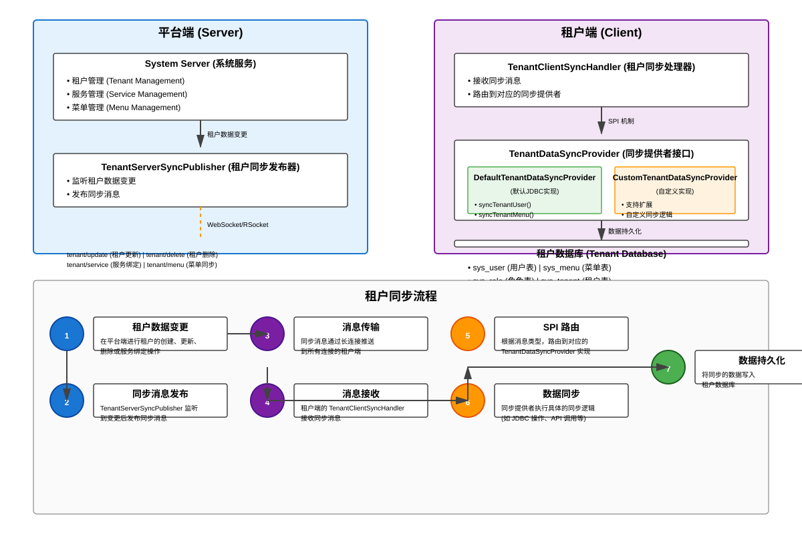

# spring-api-support-system-starter

## 📖 模块简介

**系统管理应用** - 提供完整的系统管理功能，包括用户管理、角色管理、菜单管理、部门管理等基础系统服务。

## ✨ 核心功能

### 👥 用户管理

- ✅ 用户增删改查
- ✅ 用户状态管理（启用/禁用）
- ✅ 用户密码重置
- ✅ 用户角色分配
- ✅ 用户部门管理

### 🔐 角色管理

- ✅ 角色增删改查
- ✅ 角色权限分配
- ✅ 角色菜单关联
- ✅ 角色数据权限

### 📋 菜单管理

- ✅ 菜单树形结构
- ✅ 菜单权限控制
- ✅ 动态路由生成
- ✅ 按钮权限管理

### 🏢 部门管理

- ✅ 部门树形结构
- ✅ 部门层级管理
- ✅ 部门用户关联

### 🎖️ 成就系统

- ✅ 多分组段位成就体系（登录/签到/菜单/消息/头像框）
- ✅ JSON 结构化规则引擎（and/or 逻辑组合 + 数值比较算子）
- ✅ KV 存储抽象层（FileKvEngine / RedisKvEngine 可切换）
- ✅ Spring Event 事件驱动（业务模块上报行为，成就模块消费判定）
- ✅ 异步事件监听（@Async 不阻塞调用方）
- ✅ REST API（已解锁列表/统计概览/段位定义/未解锁段位）
- ✅ 成就推送（日志默认 / WebSocket 可扩展）

## 🚀 快速开始

### 1. 环境要求

- JDK 21+
- Maven 3.8+
- MySQL 8.0+
- Redis 6.0+

### 2. 数据库初始化

```sql
-- 创建数据库
CREATE DATABASE system DEFAULT CHARACTER SET utf8mb4 COLLATE utf8mb4_unicode_ci;

-- 执行系统初始化脚本
-- 位于 src/main/resources/db/init/V1.0__init_system.sql

-- 执行成就模块表脚本
-- 位于 src/main/resources/sql/achievement.sql
```

### 3. 配置文件

**主配置文件**：`application.yml`

```yaml
spring:
  application:
    name: system
  profiles:
    active: dev
    include: common,mybatis,swagger,api,ip,actuator

server:
  port: 18170
  servlet:
    context-path: /system/api
```

**插件配置文件**：`config/application-common.yml`

```yaml
plugin:
  system:
    server:
      # 启用系统服务（默认true）
      enable: true
      # 缓存配置
      cache:
        enable: true
        expire: 3600
      # 日志配置
       log:
         enable: true
         async: true

  kvstore:
    type: file          # 开发环境使用文件存储
    file-dir: data/kvstore
```

### 4. 启动服务

#### IDE 启动

运行 `com.chua.starter.system.SystemApplication`

#### 命令行启动

```bash
cd spring-api-support-system-starter
mvn spring-boot:run
```

### 5. 静态登录联调模式

本模块支持 `dev-static` 静态登录模式，用于本地只启动系统服务和系统前端时联调，无需额外启动 OAuth 服务端。

```bash
mvn -pl spring-api-support-system-starter spring-boot:run -Dspring-boot.run.profiles=dev-static -Dspring-boot.run.arguments=--server.port=18175
```

关键点：

- `application.yml` 默认激活 `dev-static`
- `application-dev-static.yml` 将 `plugin.oauth.protocol` 设为 `static`
- 本地联调脚本默认把 system 启到 `18175`，避免和现有 `18170` 实例冲突
- 前端登录页会提供“静态登录测试”入口，适合开发/测试环境快速进入系统
- 如需完整单点登录链路，请改用 `dev` 并同时启动 `spring-api-support-oauth-starter`

## 📦 模块结构

```
spring-api-support-system-starter/
├── src/main/java/com/chua/starter/system/
│   ├── SystemApplication.java           # 启动类
│   ├── controller/                      # 控制器层
│       ├── service/                         # 服务层
    │   └── achievement/                 # 成就系统子模块
    │       ├── controller/              # 成就 REST 控制器
    │       ├── service/                 # 成就核心业务（RuleEngine + AchievementService）
    │       ├── listener/                # 事件监听（AchievementEventListener）
    │       ├── kvstore/                 # KV 存储抽象层（FileKvEngine）
    │       ├── mapper/                  # 成就数据访问
    │       ├── model/                   # 成就实体（AchievementTier / UserAchievement）
    │       ├── dto/                     # 成就响应 DTO
    │       └── event/                   # Spring 事件（UserActionEvent）
│   ├── mapper/                          # 数据访问层
│   └── properties/                      # 配置属性
│       └── SystemProperties.java        # 系统配置
└── src/main/resources/
    ├── application.yml                  # 主配置
    ├── config/
    │   ├── application-common.yml       # 通用配置
    │   ├── application-mybatis.yml      # MyBatis配置
    │   ├── application-swagger.yml      # Swagger配置
    │   └── ...
    └── mapper/                          # MyBatis XML
```

## ⚙️ 配置说明

### 功能开关配置

**配置文件**：`config/application-common.yml`

```yaml
plugin:
  system:
    server:
      # 是否启用系统服务
      # 默认: true
      # 说明: 设置为false时，整个系统服务不会启动
      enable: true
```

### 依赖的其他配置

系统服务依赖以下配置模块（通过 `spring.profiles.include` 引入）：

- **common** - 通用功能开关配置
- **mybatis** - MyBatis 数据库配置
- **swagger** - API 文档配置
- **api** - API 统一配置
- **ip** - IP 地址解析配置
- **actuator** - 监控端点配置

## 📋 API 接口

### 用户管理接口

```
GET    /v1/user/page              # 用户分页查询
GET    /v1/user/{id}              # 获取用户详情
POST   /v1/user                   # 创建用户
PUT    /v1/user/{id}              # 更新用户
DELETE /v1/user/{id}              # 删除用户
POST   /v1/user/{id}/reset-pwd    # 重置密码
PUT    /v1/user/{id}/status       # 修改用户状态
```

### 角色管理接口

```
GET    /v1/role/page              # 角色分页查询
GET    /v1/role/{id}              # 获取角色详情
POST   /v1/role                   # 创建角色
PUT    /v1/role/{id}              # 更新角色
DELETE /v1/role/{id}              # 删除角色
POST   /v1/role/{id}/perms        # 分配权限
```

### 菜单管理接口

```
GET    /v1/menu/tree              # 获取菜单树
GET    /v1/menu/{id}              # 获取菜单详情
POST   /v1/menu                   # 创建菜单
PUT    /v1/menu/{id}              # 更新菜单
DELETE /v1/menu/{id}              # 删除菜单
GET    /v1/menu/user/routes       # 获取用户路由
```

### 部门管理接口

```
GET    /v1/dept/tree              # 获取部门树
GET    /v1/dept/{id}              # 获取部门详情
POST   /v1/dept                   # 创建部门
PUT    /v1/dept/{id}              # 更新部门
DELETE /v1/dept/{id}              # 删除部门
```

### 成就系统接口

```
GET    /achievement/my/{userId}                   # 查询用户已解锁成就列表
GET    /achievement/stats/{userId}                 # 查询用户成就统计概览
GET    /achievement/tiers/{type}                   # 查询指定分组下的段位定义
GET    /achievement/uncompleted/{userId}/{type}    # 查询用户尚未解锁的段位
```

## 🔧 使用示例

### 创建用户

```bash
curl -X POST http://localhost:18170/system/api/v1/user \
  -H "Content-Type: application/json" \
  -H "x-oauth-token: your_token" \
  -d '{
    "username": "zhangsan",
    "password": "123456",
    "realName": "张三",
    "email": "zhangsan@example.com",
    "phone": "13800138000",
    "deptId": 1,
    "roleIds": [1, 2]
  }'
```

### 分配角色权限

```bash
curl -X POST http://localhost:18170/system/api/v1/role/1/perms \
  -H "Content-Type: application/json" \
  -H "x-oauth-token: your_token" \
  -d '{
    "menuIds": [1, 2, 3, 4, 5]
  }'
```

## 🏗️ 系统架构

### 完整系统架构图

[成就系统架构图](docs/架构图.md)

### 模块依赖关系

```
spring-api-support-system-starter (系统应用)
    ↓ 依赖
spring-api-support-common-system-starter (系统服务模块)
    ↓ 依赖
spring-api-support-common-oauth-starter (OAuth认证模块)
    ↓ 依赖
spring-api-support-common-entity-starter (实体定义)
spring-api-support-common-configuration-starter (配置定义)
```

### 租户同步架构

系统支持多租户架构，通过同步机制实现租户数据的实时同步：



### 租户同步流程

1. **租户数据变更**：在平台端进行租户的创建、更新、删除或服务绑定操作
2. **同步消息发布**：`TenantServerSyncPublisher` 监听到变更后，通过 WebSocket/RSocket 发布同步消息
3. **消息传输**：同步消息通过长连接推送到所有连接的租户端
4. **消息接收**：租户端的 `TenantClientSyncHandler` 接收同步消息
5. **SPI 路由**：根据消息类型，路由到对应的 `TenantDataSyncProvider` 实现
6. **数据同步**：同步提供者执行具体的同步逻辑（如 JDBC 操作、API 调用等）
7. **数据持久化**：将同步的数据写入租户数据库

### 同步消息类型

| 消息主题 | 说明 | 触发时机 |
|---------|------|---------|
| `tenant/update` | 租户更新 | 租户信息修改时 |
| `tenant/delete` | 租户删除 | 租户删除时 |
| `tenant/service` | 服务绑定 | 租户服务绑定变更时 |
| `tenant/menu` | 菜单同步 | 租户菜单权限变更时 |

### 配置说明

**平台端配置**（`application-common.yml`）：

```yaml
plugin:
  mybatis-plus:
    tenant:
      server:
        enable: true          # 启用服务端模式
        sync-enable: true     # 启用同步功能
        sync-module: rsocket-sync  # 同步模块类型
```

**租户端配置**（`application-common.yml`）：

```yaml
plugin:
  mybatis-plus:
    tenant:
      client:
        enable: true          # 启用客户端模式
        sync-enable: true     # 启用同步功能
        sync-module: rsocket-sync  # 同步模块类型
      sync-protocol:
        enable: true
        protocol: rsocket
        server-address: ws://platform-server:19280
```

## 📊 数据库表结构

### sys_user - 用户表

```sql
CREATE TABLE `sys_user` (
  `sys_user_id` bigint NOT NULL AUTO_INCREMENT COMMENT '用户ID',
  `sys_user_username` varchar(50) NOT NULL COMMENT '用户名',
  `sys_user_password` varchar(100) NOT NULL COMMENT '密码',
  `sys_user_nickname` varchar(50) COMMENT '昵称',
  `sys_user_email` varchar(100) COMMENT '邮箱',
  `sys_user_phone` varchar(20) COMMENT '手机号',
  `sys_user_status` tinyint DEFAULT 1 COMMENT '状态：0-禁用，1-启用',
  PRIMARY KEY (`sys_user_id`)
) COMMENT='用户表';
```

### sys_role - 角色表

```sql
CREATE TABLE `sys_role` (
  `sys_role_id` bigint NOT NULL AUTO_INCREMENT COMMENT '角色ID',
  `sys_role_name` varchar(50) NOT NULL COMMENT '角色名称',
  `sys_role_code` varchar(50) NOT NULL COMMENT '角色编码',
  `sys_role_status` tinyint DEFAULT 1 COMMENT '状态',
  PRIMARY KEY (`sys_role_id`)
) COMMENT='角色表';
```

### sys_menu - 菜单表

```sql
CREATE TABLE `sys_menu` (
  `sys_menu_id` bigint NOT NULL AUTO_INCREMENT COMMENT '菜单ID',
  `sys_menu_parent_id` bigint DEFAULT 0 COMMENT '父菜单ID',
  `sys_menu_name` varchar(50) NOT NULL COMMENT '菜单名称',
  `sys_menu_path` varchar(200) COMMENT '路由路径',
  `sys_menu_type` varchar(20) COMMENT '菜单类型：MENU/BUTTON',
  PRIMARY KEY (`sys_menu_id`)
) COMMENT='菜单表';
```

## 🔗 相关文档

- [成就系统架构文档](docs/架构图.md)
- [OAuth 认证模块](../spring-api-support-common-oauth-starter/README.md)
- [系统服务模块](../spring-api-support-common-system-starter/README.md)
- [项目整体文档](../README.md)

## 📝 API 文档

启动服务后，访问 Swagger 文档：

```
http://localhost:18170/system/api/doc.html
```

## 🐛 故障排除

### 常见问题

#### 1. 服务无法启动

检查配置：

```yaml
plugin:
  system:
    server:
      enable: true # 确保已启用
```

#### 2. 数据库连接失败

检查数据源配置：

```yaml
spring:
  datasource:
    url: jdbc:mysql://localhost:3306/system
    username: root
    password: your_password
```

#### 3. OAuth 认证失败

检查 OAuth 客户端配置：

```yaml
spring:
  oauth:
    client:
      server-url: http://localhost:19180
      client-id: your-client-id
      client-secret: your-client-secret
```

## 📄 许可证

本项目采用 Apache License 2.0 许可证。

---

**作者**: CH  
**版本**: 4.0.0.42  
**更新时间**: 2026/08/07
